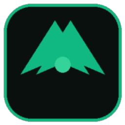
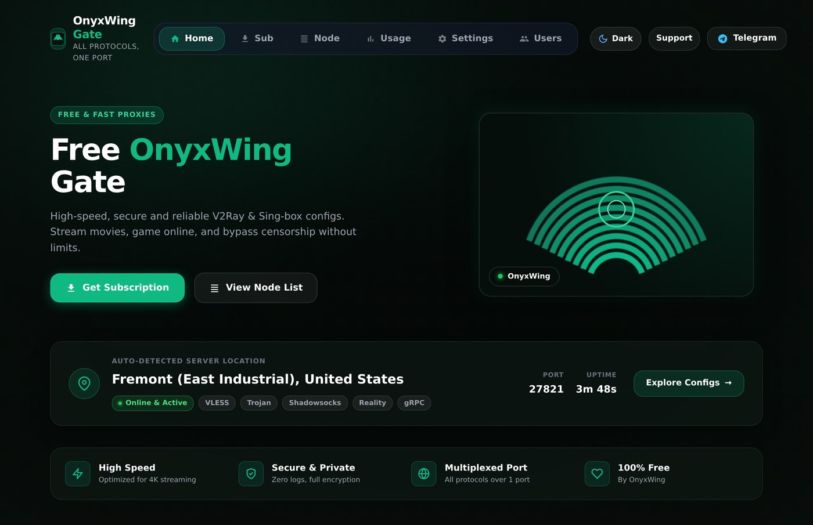
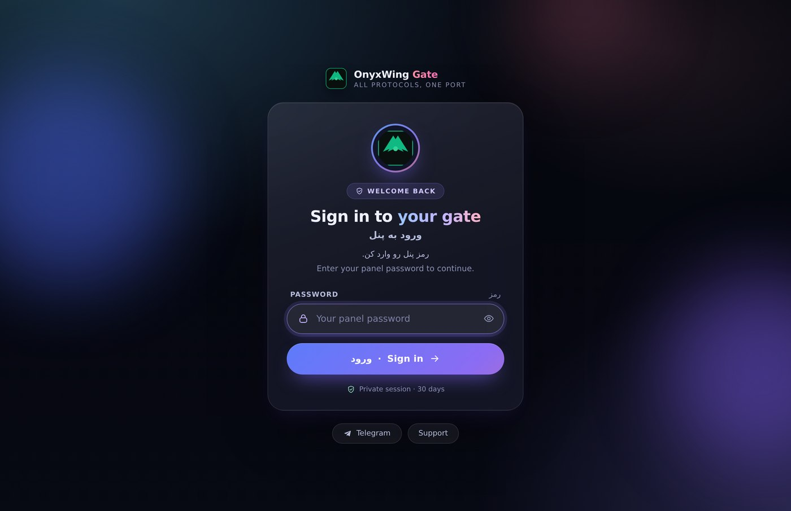
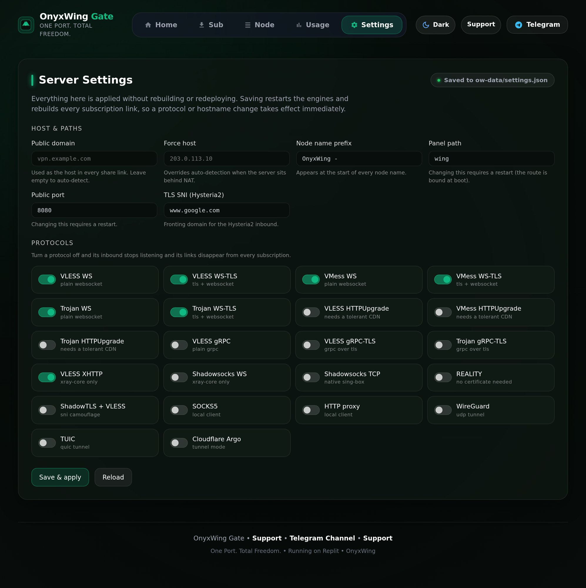

<div align="center">



# OnyxWing Gate

**One port. Total freedom.**

</div>

A VLESS / VMess / Trojan / Shadowsocks / XHTTP panel that runs on free hosts
(Pterodactyl, Replit, Railway…) using the one port your server is given.
No database, no build step — upload and run.



## Features

- **One port, many protocols** — everything multiplexed on the single public port
- Web panel with QR codes, subscription links, traffic stats
- **Settings page** — host, node prefix, panel path and every protocol toggle, applied without redeploying
- Subscription generator: Base64 / Clash / sing-box / WireGuard
- **Panel outbounds** — one click exports each node as Xray outbound JSON (works as a node in 3x-ui / s-ui / x-ui), TLS pinned via `pinnedPeerCertSha256` so it loads on modern xray-core
- Themes: **Dark Cinema** (obsidian/emerald) & **Cozy** (midnight teal)
- Password-protected panel (scrypt), brute-force lockout, 30-day sessions
- Auto-downloads **sing-box** & **Xray-core** on first start (SHA-256 checked)

## Login



## Quick Start

1. Create a **Node.js** server (Node 18+, 20 recommended).
2. Upload `index.js`, `package.json` and the `assets/` folder (no `node_modules` — it installs itself).
3. Start command: `node index.js` (port is read from `SERVER_PORT` automatically).
4. First start downloads the cores — give it a minute.
5. Open `http://<server-ip>:<port>/wing` and create your panel password.
6. Copy configs or the subscription link into your client (v2rayN / v2rayNG / Hiddify / Streisand / Nekobox).

**Keep the `ow-data/` folder** — it holds your password hash, UUID and TLS certificate. Delete it and every config/UUID changes.

## Configs (all on the same single port)

| Config | Works in |
|---|---|
| VLESS-WS / VLESS-WS-TLS | all clients |
| VMess-WS / VMess-WS-TLS | all clients |
| Trojan-WS / Trojan-WS-TLS | all clients (Clash: use Trojan-WS-TLS only) |
| VLESS / VMess / Trojan HTTPUpgrade | Xray, sing-box (Clash: VLESS & VMess only) |
| VLESS-gRPC / VLESS-gRPC-TLS | most clients |
| VLESS-XHTTP | Xray-based clients |
| Shadowsocks-WS | v2ray-plugin compatible clients |
| WireGuard | via `wg.conf` download |

## Optional env vars

`PORT`/`SERVER_PORT`, `BIND_ADDR`, `OW_DATA_DIR`, `PANEL_PASSWORD`, `SUB_TOKEN`, `LINK_HOST`/`LINK_PORT`, `UUID`, `TRAFFIC_LIMIT_GB`, `XRAY_VERSION` — set what you need, defaults are fine for most cases.

## Settings

Env vars set the starting point; after that everything lives in `ow-data/settings.json` and can be
changed from **Settings** in the panel:



- domain / forced host, node name prefix, panel path, public port
- per-protocol on/off switches (HTTPUpgrade, gRPC, XHTTP, REALITY, WireGuard…)

Saving restarts the engines and rebuilds every subscription link in place. Panel path and public
port are bound when the process boots, so those two ask for a restart. Unknown keys and
out-of-range values are rejected instead of written, so a typo can't break the config.

```json
{
  "nodePrefix": "OnyxWing - ",
  "enable": { "vlessHttpUpgrade": false, "reality": true }
}
```

## Support

- 💬 Telegram: [@master_supports](https://t.me/master_supports)

## License

MIT — see [LICENSE](LICENSE)
